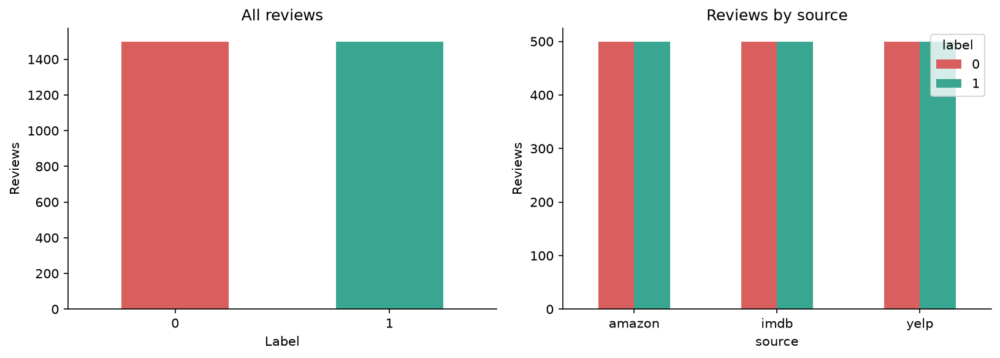
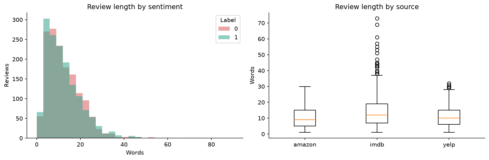
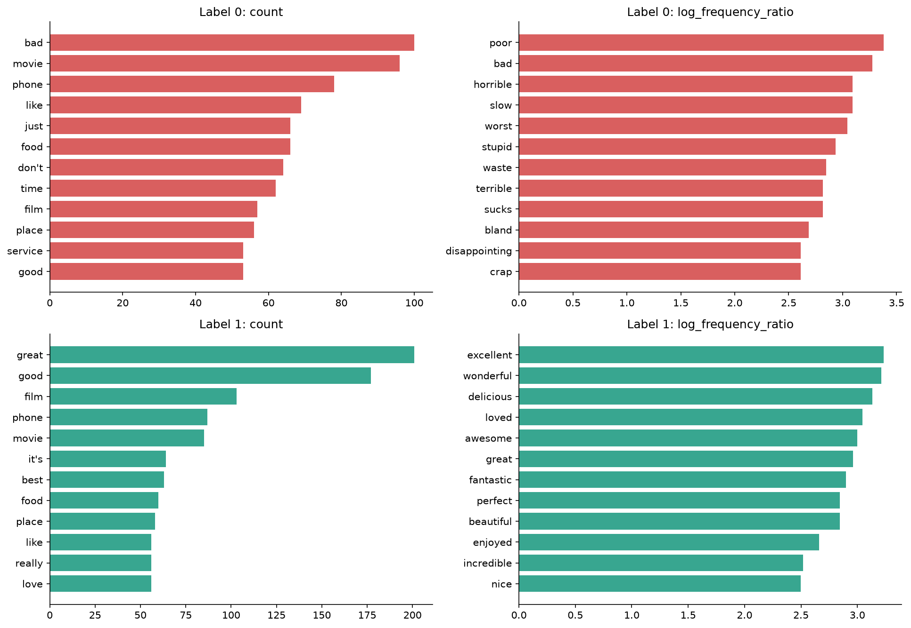
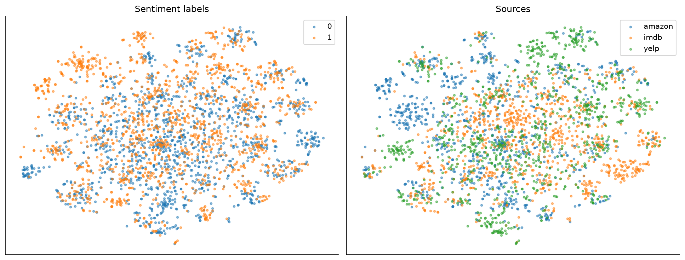
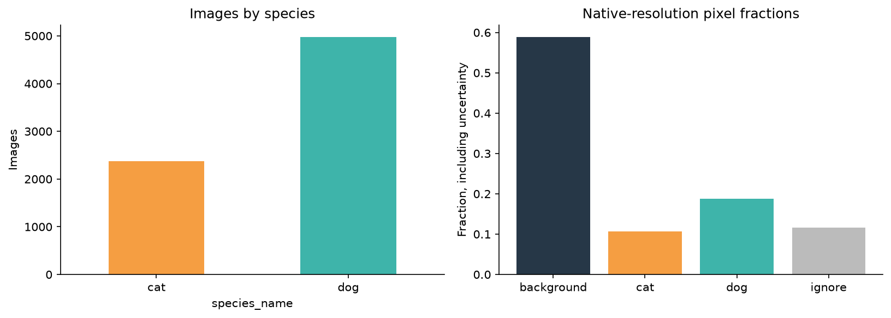
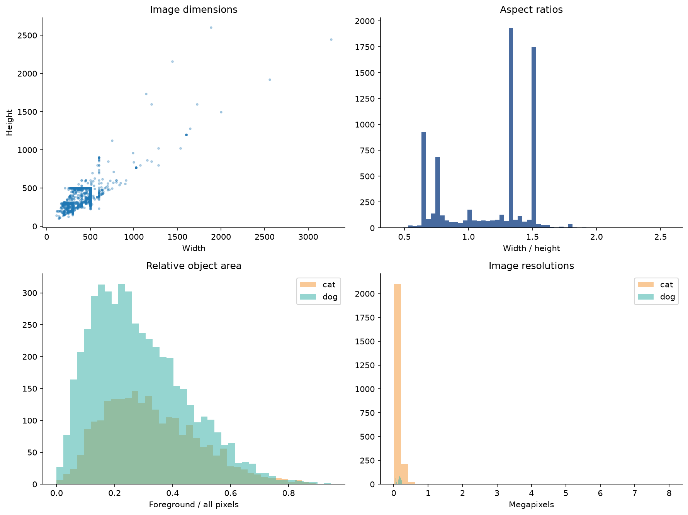
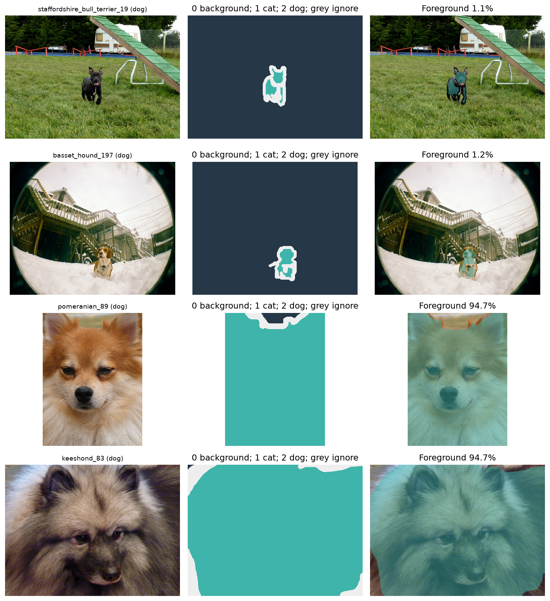
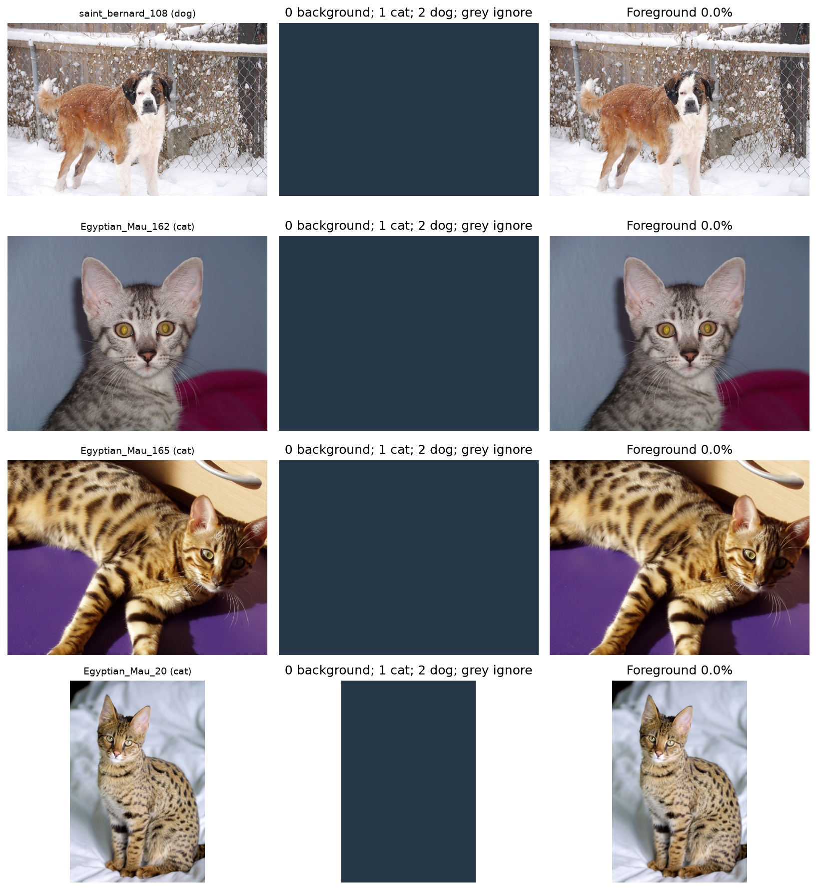
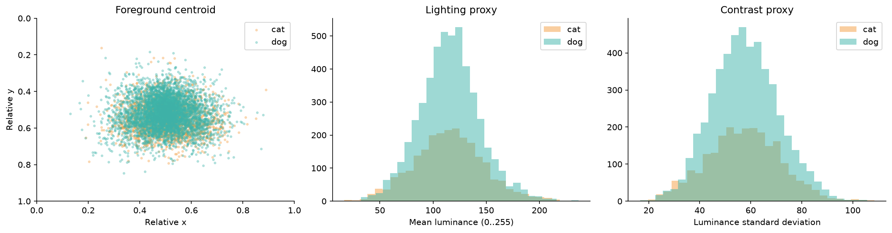
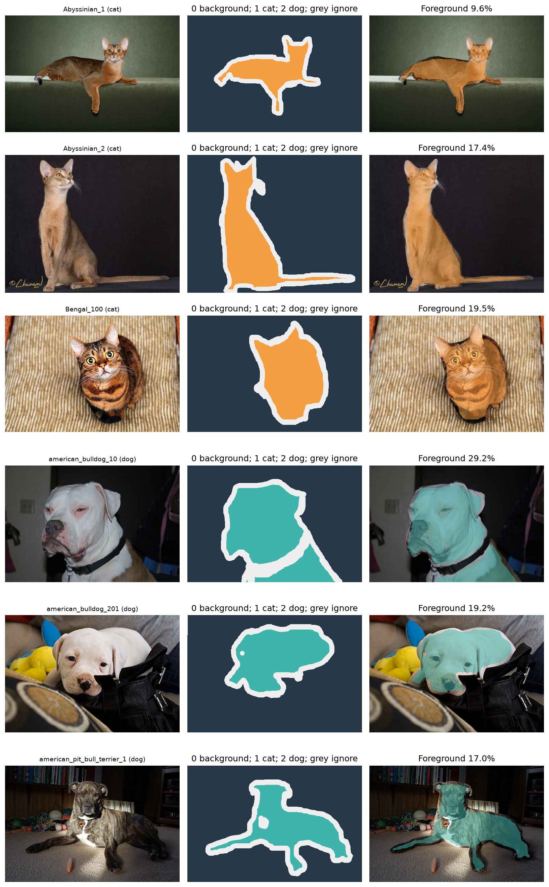

# Отчёт EDA: Sentiment Labelled Sentences и Oxford-IIIT Pet

Дата анализа: 17 ноября 2026. План: [PLAN.md](../PLAN.md). Источники и условия использования: [DATA_SOURCES.md](../DATA_SOURCES.md). Все значения ниже рассчитаны по полным официальным данным; свой набор размеченных изображений пользователем не передан. Случайное зерно: **42**.

## Основные результаты

- Тексты: **3000** записей, по **1500** меток 0 и 1. Пропусков, пустых текстов и конфликтов меток у одинаковых нормализованных отзывов не найдено. После нормализованной дедупликации остаётся **2972** записей.
- Животные: **7349** записей официальных метаданных; кошки — **2371**, собаки — **4978**, 37 пород. На диске JPEG — **7390**, PNG-масок — **7390**. Лишние относительно метаданных файлы и ошибки перечислены отдельно.
- Задача животных — **семантическая сегментация**, маски **0 background / 1 cat / 2 dog**. Неопределённые пиксели исходного trimap получают **255 ignore**. В собственной разметке пользователя закрашены только кошки и собаки; фон получается автоматически из незакрашенных пикселей и не требует отдельной закраски.
- Сохранены официальные test-изображения и подготовлена validation из trainval. Связанные с test группы исключены из trainval. Итоговые выборки не пересекаются по именам, байтам, декодированным пикселям и группам perceptual-кандидатов.

## 1. Sentiment Labelled Sentences

### Структура и качество

Три TXT без заголовка; поля `text` (строка), `label` (целое 0/1). Добавлены `id`, `source`, номера исходных строк. UTF-8 декодируется строго, разделитель — последняя TAB, кавычки сохраняются как часть текста. Два символа NEL (U+0085) в IMDb находятся внутри отзывов и не должны разрывать записи. Применение `splitlines()` или стандартного CSV quoting способно изменить число разобранных записей. Фактически прочитано по 1000 записей каждого источника.

| source | 0 | 1 |
| --- | --- | --- |
| amazon | 500 | 500 |
| imdb | 500 | 500 |
| yelp | 500 | 500 |

Точные повторы определяются по исходному текстовому полю, включая хвостовые пробелы. Нормализованные — по NFC + casefold + замене Unicode-пунктуации пробелами + свёртке пробелов.

| Проверка | Групп | Строк в группах | Лишних строк сверх одной на группу |
| --- | --- | --- | --- |
| Точные повторы | 17 | 34 | 17 |
| После нормализации | 21 | 49 | 28 |
| Противоречащие метки | 0 | 0 | — |

Отсутствие конфликтов одинаковых текстов не доказывает корректность каждой метки. Полные группы: `tables/sentiment_duplicates_*.csv`; аномалии символов: `tables/sentiment_parse_anomalies.csv`.

### Длины, источники и словарь

Символы считаются в исходном тексте, слова — регулярным выражением с внутренними апострофами. Перцентили считаются по всем 3000 строкам, включая повторы.

| показатель | min | max | mean | 50% | 5% | 95% | 99% |
| --- | --- | --- | --- | --- | --- | --- | --- |
| chars | 7.000 | 479.000 | 65.271 | 55.500 | 17.000 | 142.000 | 215.030 |
| words | 1.000 | 73.000 | 11.891 | 10.000 | 3.000 | 26.000 | 36.000 |

Средние длины в словах: Amazon **10.29**, IMDb **14.48**, Yelp **10.91**. IMDb заметно длиннее; это согласуется с более развёрнутыми описаниями фильмов. Распределения по меткам и источникам приведены на графике; полный набор перцентилей — в CSV.

| source | частые слова | характерные слова |
| --- | --- | --- |
| amazon | phone, great, good, product, quality, headset, works, battery | phone, headset, battery, ear, product, charger, bluetooth, reception |
| imdb | movie, film, bad, it's, just, good, like, acting | movie, film, acting, characters, plot, story, films, script |
| yelp | food, place, good, service, great, like, time, really | food, restaurant, delicious, vegas, eat, staff, chicken, menu |

Для частот использованы английские стоп-слова, слова минимум в двух документах; характерность — логарифм отношения сглаженных относительных частот группы к остальному корпусу (сглаживание +1). На графике характерных слов требуется минимум 5 документов. Для negative характерны `poor`, `bad`, `horrible`, `slow`, для positive — `excellent`, `wonderful`, `delicious`, `loved`. Предметные слова источников показывают доменное смещение.

### Проекция TF-IDF

TF-IDF → TruncatedSVD(50) → t-SNE, perplexity=35, 1000 итераций, seed=42. SVD объясняет **23.8%** дисперсии. Визуально есть локальные группы тональности и доменов, но глобального разделения двух меток нет. Проекция не является оценкой классификатора. Она и частотный анализ используют весь корпус только в EDA; для будущей модели словарь/IDF обучаются строго по train.

### Выборочная смысловая проверка меток

Проверены 18 воспроизводимо выбранных примеров (по 3 на source×label), а также кандидаты с отрицанием/смешанными словами и очень короткие отзывы. Результаты с ID сохранены в [SENTIMENT_REVIEW.md](SENTIMENT_REVIEW.md). Большинство выбранных меток соответствует выраженной оценке. Найден кандидат на ошибочную метку: `amazon_0365`, отрицательное сравнение устройства с S11 имеет исходную метку 1. Метка **не изменена автоматически**. `amazon_0883` смешивает ограниченную похвалу с общим отрицательным оттенком; требуется контекст. `amazon_0768` выглядит обрезанным. Это ограниченная проверка ассистентом, а не независимая экспертная переразметка всех данных.

### Разбиение и очистка

После удаления 28 нормализованных повторов — 2972 строк. Первый представитель выбирается сортировкой по source/id; поэтому небольшое изменение баланса источников возможно. Train/validation/test = 70/15/15, стратификация source×label. Конфликтующие группы исключались бы целиком; здесь их нет.

| split | source | 0 | 1 |
| --- | --- | --- | --- |
| test | amazon | 74 | 74 |
| test | imdb | 74 | 75 |
| test | yelp | 74 | 75 |
| train | amazon | 346 | 342 |
| train | imdb | 348 | 349 |
| train | yelp | 346 | 349 |
| validation | amazon | 74 | 73 |
| validation | imdb | 75 | 74 |
| validation | yelp | 75 | 75 |

Итого: **train 2080**, **validation 446**, **test 446**. Пересечений по нормализованным текстам — **0**. Манифест уникальных отзывов: `data/processed/sentiment_splits.csv`; все 3000 строк со связью с разбиением: `sentiment_all_rows.csv`.

Для моделирования сохранять отрицания, апострофы и эмоциональную пунктуацию; свёртку пробелов/NEL можно применять без потери смысла. Ключ дедупликации не подменяет входной текст. Аугментации выполняются только в train после разбиения. Ограничения: английский язык, короткие отобранные полярные отзывы, отсутствие нейтрального класса, искусственный баланс, доменные различия и возможный шум меток. Такое разбиение оценивает смесь трёх знакомых доменов; перенос на новый домен требует отдельной проверки с исключением источника из train.

## 2. Oxford-IIIT Pet — семантическая сегментация

### Инвентаризация и читаемость

| Проверка | Результат |
| --- | --- |
| Строк официальных метаданных | 7349 |
| Изображений JPEG / PNG-масок на диске | 7390 / 7390 |
| Служебных файлов AppleDouble (не маски) | 7390 |
| Изображений / масок вне официального списка | 41 / 41 |
| Нечитаемых изображений / масок среди всех файлов | 0 / 0 |
| Отсутствующих изображений / масок в метаданных | 0 / 0 |
| Невалидных строк метаданных | 0 |
| Несовпадений размеров image / mask | 0 |
| Пикселей с недопустимым исходным значением | 0 |
| Масок без foreground среди всех / официальных | 23 / 14 |

Проверяются все настоящие изображения и маски, а не только выборка. Служебные `._*.png` распознаны по сигнатуре AppleDouble и перечислены в `tables/pets_auxiliary_files.csv`; они не считаются повреждёнными PNG. Полная инвентаризация: `tables/pets_file_inventory.csv`, аудит изображений и масок: `pets_image_audit.csv`, `pets_mask_audit.csv`. Не включённые в метаданные пары не добавляются в официальные разбиения; они сохраняются для проверки происхождения. Метаданные trainval/test согласованы с list.txt, пересечений имён в официальных списках нет. Маски без foreground имеют допустимую кодировку и сохраняются в выборках, включая официальный test; это отдельный риск качества разметки.

### Преобразование разметки

Проверена однозначность `class_id → species` для всех 37 пород; регистр первого символа имени совпадает с видом, но основой преобразования служит поле SPECIES. Маски исходно одноканальные PNG; исходная кодировка подтверждена README архива:

| Исходный trimap | Значение | Целевая маска |
| --- | --- | --- |
| 1 | foreground | 1 для cat, 2 для dog |
| 2 | background | 0 |
| 3 | not classified | 255 (ignore) |

255 — служебная неопределённость, не четвёртый класс задачи. Исходную неопределённость нельзя автоматически отождествлять с фоном. В собственных масках пользователя закрашиваются только коты и собаки; при полной разметке целевых животных все незакрашенные пиксели получают 0. Для таких собственных масок допустимы только 0/1/2. Собственные цветные маски перед импортом требуют явного сопоставления цветов классам.

### Баланс изображений и пикселей

| species_name | test | trainval |
| --- | --- | --- |
| cat | 1183 | 1188 |
| dog | 2486 | 2492 |

Кошки составляют **32.3%**, собаки — **67.7%**. Дисбаланс обусловлен числом пород каждого вида; это не меняется объединением пород в два класса.

| class | pixels | fraction_all | fraction_supervised |
| --- | --- | --- | --- |
| background | 758472669 | 0.589 | 0.666 |
| cat | 137533110 | 0.107 | 0.121 |
| dog | 242517696 | 0.188 | 0.213 |
| ignore | 149081782 | 0.116 | nan |

Пиксели суммируются на исходном разрешении по валидным официальным парам. Это взвешивание по числу пикселей, а не среднее по изображениям. Доля неопределённых пикселей — **11.6%**. Для оценки трёх классов использовать знаменатель без ignore; классовые веса для модели рассчитывать отдельно по train.

### Геометрия и размер объекта

Медианные размеры: ширина **500**, высота **375** пикселей (это отдельные медианы, не гарантированная пара размера). Диапазоны ширины **114–3264**, высоты **103–2606**. Изображения нельзя считать одинаковыми по размеру и отношению сторон.

Foreground / все пиксели: минимум **0.00%**, медиана **27.41%**, максимум **94.68%**. Масок с foreground меньше 1% площади: **14**, из них непустых — **0**; больше 90%: **5**. Достоверный foreground не включает неопределённую границу. Кандидаты экстремумов, их ID и размеры: `tables/pets_extreme_objects.csv`.

Центроид считается по пикселям foreground, нормализуется на ширину/высоту. Средняя яркость/контраст изображения и отдельно фона служат описательными прокси; они не являются объективной классификацией освещения или типов сцен. Групповые статистики — `tables/pets_statistics_by_species.csv`. Визуальные наблюдения по исходникам, маскам и оверлеям сохранены в [PETS_VISUAL_REVIEW.md](PETS_VISUAL_REVIEW.md).

### Дубликаты и защита от утечки

Подсчитаны SHA-256 исходных файлов и декодированного RGB с формой массива. Строк в группах точных RGB-дубликатов среди всех файлов: **59**. Perceptual hash: resize 32×32, DCT 8×8, DC не учитывается в пороге, 64-битное представление, Hamming ≤6. Найдено **82** пар кандидатов, из них **24** пересекают исходный trainval/test. Полный список — `tables/pets_perceptual_duplicate_candidates.csv`; это кандидаты, не гарантированные одинаковые фотографии.

Связные компоненты объединяют точные и perceptual пары. Все допустимые официальные test-строки сохраняются; связанные trainval-строки получают `excluded_test_overlap`. Это консервативный выбор: ложные кандидаты могут избыточно исключать данные. Из оставшегося trainval выделена validation первым fold `StratifiedGroupKFold(n_splits=5, shuffle=True, random_state=42)`, стратификация по породам, группировка по компонентам дубликатов. Test не используется для выбора параметров будущей модели; хеш-сверка служит только аудиту утечки.

| split | cat | dog |
| --- | --- | --- |
| excluded_test_overlap | 6 | 18 |
| test | 1183 | 2486 |
| train | 945 | 1981 |
| validation | 237 | 493 |

Итоговые размеры и причины исключений: `{'test': 3669, 'train': 2926, 'validation': 730, 'excluded_test_overlap': 24}`. Внутри официального test возможные повторы не удаляются, чтобы сохранять исходный benchmark. Пересечений между итоговыми train/validation/test по ID, байтам, RGB и duplicate_group — **0**. Хеширование не находит все изменения кадра и не устанавливает идентичность животных: общие питомцы и похожие сцены всё ещё могут завышать оценку качества.

### Подготовка и новые изображения

- Геометрические преобразования RGB и маски выполняются синхронно. Для RGB — bilinear/bicubic, для масок — **только nearest neighbour**. Реализован `coursework.preprocess.letterbox`, сохраняющий пропорции; маска на полях получает 255.
- Не применять EXIF-поворот только к изображению. Хранить согласованную ориентацию и одинаковые размеры image/mask.
- Экспорт разметки: JPEG RGB + одноканальный PNG uint8 с 0/1/2 (или 255 для явной неопределённости), одинаковое базовое имя. Фон не закрашивается отдельно. Разметить все видимые целевые животные; при наличии обоих видов использовать соответствующие классы на каждом объекте.
- Сохранять происхождение, права, ID животного/серии, координаты и версию разметки. Серии одного животного и повторные кадры целиком размещать в одной выборке. При спорной границе договориться об одном правиле и использовать ignore при необходимости.
- Маски без foreground не использовать как корректную обучающую разметку до проверки/исправления: для обучения фильтровать `empty_foreground`, сохраняя официальный test для сопоставимости. Отдельно сообщать число таких test-примеров и влияние дефектной разметки на метрики.
- Аугментации — только в train после разбиения. Для обучения сегментации настроить `ignore_index=255`, считать IoU по background/cat/dog без ignore и сообщать метрики каждого класса.

Ограничения: дисбаланс видов и пикселей, разные фоны/освещение/ракурсы, неопределённые границы, потенциальные ошибки species и масок, отсутствие ID животных. Вид из метаданных назначается всему foreground; наличие другого животного в кадре этим не проверяется. Предварительная визуальная проверка не подтверждает качество каждой из 7349 аннотаций.

## 3. Воспроизводимость и проверка

Полные команды — в [README.md](../README.md). Архивы и SHA-256 — `data/sources.json`; окружение — `environment.json`, `requirements.txt`, `requirements-notebook.txt`. Оба ноутбука выполнены с сохранёнными выводами. Скрипты можно запускать без Jupyter. Проверки: смысл trimap и 255, resize без новых меток, сохранение всех 3000 отзывов, баланс текстовых страт, отсутствие утечки и сравнение **каждой** экспортированной маски с исходной.

Результат тестов: [validation.log](validation.log). Соответствие пунктам плана: [PLAN_CHECKLIST.md](PLAN_CHECKLIST.md).
